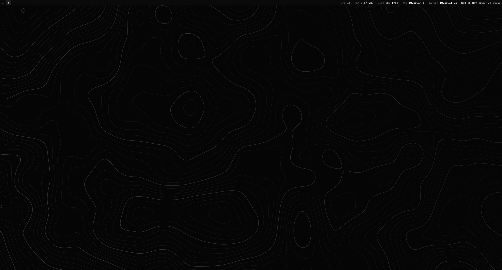
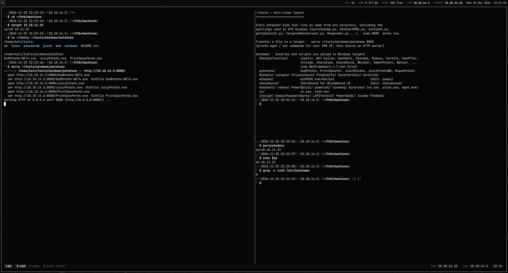

# kali-clean

Minimal i3 workstation for Kali, tailored for HTB / HackSmarter / CPTS-style labs and exams. Flat, fast, black, and intentionally compositor-free for reliable VMware use.

## ⚠️ Warning

Built with help from OpenAI's GPT-5.6 Sol and Anthropic's Claude. **Review `install.sh` and the dotfiles yourself before running them.** The installer uses `sudo` for Kali packages and installs offensive-security tooling intended only for systems and labs you are authorized to test. It never removes packages, changes no system configuration besides setting zsh as your login shell (if it isn't already) and adding you to the `docker` group (for bloodhound-cli), and backs up every dotfile it replaces.

## Install

Before running `./install.sh`, open Firefox once and create a profile (the name doesn't matter), then close Firefox. The installer applies the black theme and the extensions to that profile.

Run as your normal user, **not root**:

```bash
git clone https://github.com/flarycen/kali-clean
cd kali-clean
./install.sh
```

Choose a wallpaper, wait for the success message, reboot, then select **i3** from the login screen. Re-running `./install.sh` is safe and fills in anything that was missing.

If it says your Kali is behind its repository, packages that would need to remove something are skipped. For the full toolset run `sudo apt update && sudo apt full-upgrade -y && sudo reboot`, then `./install.sh` again.

On the Windows host, run this once in PowerShell so VMware's Ctrl+E (Power Off), Ctrl+R (Reset) and Ctrl+Z (Suspend) can't hit the VM when it doesn't have the keyboard. It sits in the tray and starts at login; inside the VM the keys keep working:

```powershell
iwr -UseBasicParsing https://raw.githubusercontent.com/flarycen/kali-clean/main/host/vmware-hotkey-guard.ps1 -OutFile $env:TEMP\vmware-hotkey-guard.ps1
powershell -NoProfile -ExecutionPolicy Bypass -File $env:TEMP\vmware-hotkey-guard.ps1 -Install
```

## QoL

- `Mod+Enter` — terminal in the focused window's cwd
- `Mod+d` — Rofi
- `Mod+Shift+B` — wallpaper picker: Contour, Black, Dots, Grid, Grain (all 4K)
- `Mod+Shift+F` — Firefox, black, with FoxyProxy (Burp `:8080`, SOCKS `:9050` / `:1080`), Wappalyzer, Cookie-Editor
- `Mod+Shift+N` — Thunar
- `Print` / `Mod+Shift+P` — Flameshot, saved to `~/Pictures/Screenshots`
- `Mod+Shift+X` — lock
- top bar — CPU, RAM, disk, VPN IP, target IP, date and time; click VPN or TARGET to copy
- prompt — two lines with the time each command ran, your VPN IP and path; typed commands are bold white for clean exam screenshots
- tmux keeps every stock `Ctrl-b` binding and adds `prefix + P` pane logging to `~/logs/tmux`, `prefix + Ctrl-s` / `Ctrl-r` to save/restore sessions, splits that keep the cwd and copies that reach the host clipboard
- `export ip=...` (or `target 10.10.11.23`), `ip2=...`, `domain=...`, etc. persist across zsh/tmux sessions until changed or unset; `ip` also shows in both bars
- every tool runs from any directory, including the Academy spellings: `secretsdump.py`, `GetUserSPNs.py`, `ssh2john.py`, `gettgtpkinit.py`, `targetedKerberoast.py`, `evil-winrm.py`, ... and `sudo ntlmrelayx.py` works
- `serve` — HTTP server for the current directory that prints `wget` / `iwr` commands for your VPN IP
- `clocksync 10.10.11.23` — puts the clock on the DC's time for Kerberos and keeps it there (VMware Tools and Internet time sync can't set it back); `clocksync off` undoes it
- `hashcat` cracks on the VM's CPU (PoCL; a VM has no GPU for it) and stops a swapped hash file and wordlist, printing the fixed command
- `~/htb`, `~/hacksmarter`, `~/vpn`, `~/tools`, `~/wordlists` are created automatically; `~/tools/README.txt` maps the Windows, Linux and pivoting binaries
- Picom is **not started**: this avoids the Thunar/GTK repaint bug confirmed under VMware
- VMware's user agent is started by i3 so host/guest clipboard and drag/drop work, and the desktop follows the VMware window size (dynamic resolution, fullscreen included)

The toolset includes the Kali-default stack plus CPTS/HTB essentials such as SecLists, BloodHound CE (Kali's package, plus bloodhound-cli in Docker on 127.0.0.1:8888; CE and legacy Python collectors), NetExec, CrackMapExec, Certipy, bloodyAD, Evil-WinRM / evil-winrm-py, Impacket, Responder, Kerbrute, windapsearch, PKINITtools, targetedKerberoast, pywhisker, krbrelayx, Coercer, Penelope, Ligolo-ng, Chisel, Kerberos prerequisites, web tooling, wordlists and common service clients, plus ready-to-upload binaries for targets (SharpCollection, winPEAS / linPEAS, pspy, potatoes, RunasCs, Sysinternals, ...).

## Look

One black theme: Pebl3's near-black palette, JetBrains Mono, square 1px borders and a white border on the focused window. No compositor is required.




## Credits

Fork/update inspired by [xct/kali-clean](https://github.com/xct/kali-clean) and [Pebl3/kali-clean](https://github.com/Pebl3/kali-clean).
